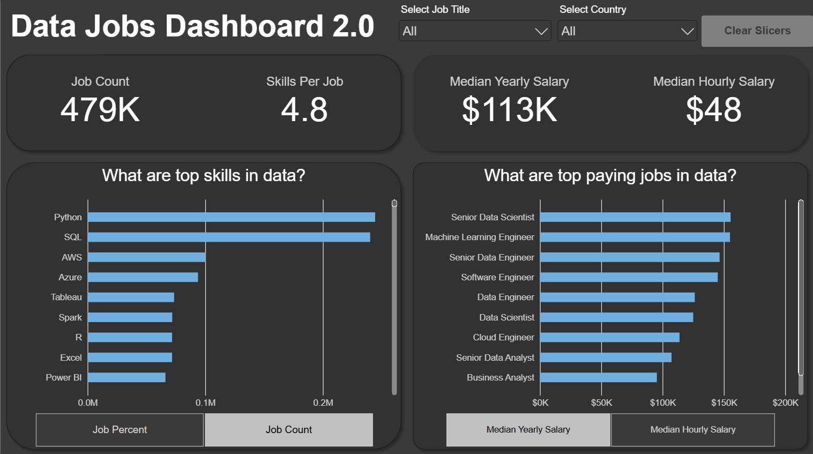

# Data Jobs Dashboard v2

## Introduction
This dashboard is designed specifically for Job Seekers, Job Transitioners and Job Swappers to make the search easier. Using a real-world dataset, this project offers a streamlined, single-page interface to quickly explore crucial market trends and compensation insights.

## Skills Showcased
- **Dashboard Design:** Crafting an intuitive and visually appealing report layout.
- **Power Query ETL:** Performing data cleaning, shaping, and transformation
- **Data Modelling:** Building efficient data models with relationships (Star Schema principles).
- **DAX Fundamentals:** Creating calculations and aggregations to derive key insights.
- **Visualisations Utilised:**
    - **Core Charts:** Column, Bar, Line and Area charts for comparisons and trends.
    - **Map Charts:** For displaying geospatial data.
    - **Cards:** To highlight key performance indicators.
    - **Tables:** For presenting detailed, tabular information.
    - **Chart Variety:** Selecting from Common and uncommon chart types for effective storytelling.

- **Interactive Features:**
    - **Slicers:** Enabling dynamic, user-driven data filtering.
    - **Buttons & Bookmarks:** For streamlined navigation and managing report views (including Drill-Through)
## Dashboard Overview

This second iteration consolidates the dashboard into a **single, focused page**, designed to give job seekers the most critical market insights at their fingertips.

This page as your concise mission control for the data job market. It showcases key performances indicators (KPIs) like **Job Count, Skills Per Job, Median Yearly Salary, and Median Hourly Salary.** You can also quickly see **Skill Popularity** (by job percent or count) and compare **Salaries across different job titles.**, all designed for an efficient overview

## Conclusion
This updated dashboard showcases Power BI's ability to transform extensive job posting data into a powerful, streamlines tool for career analysis. It empowers **Job Seekers, Transitioners and Swappers** by allowing them to filter and explore essential market insights efficiently on a single page, helping them make informed decisions about their next careers move. 