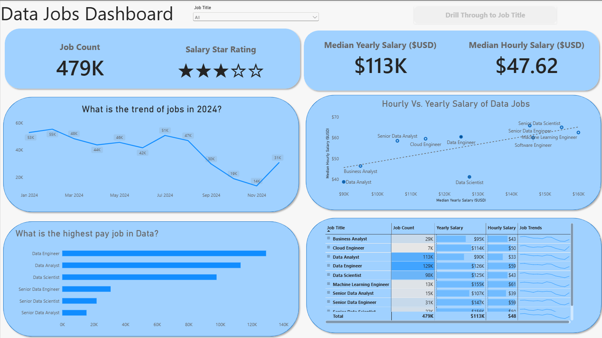
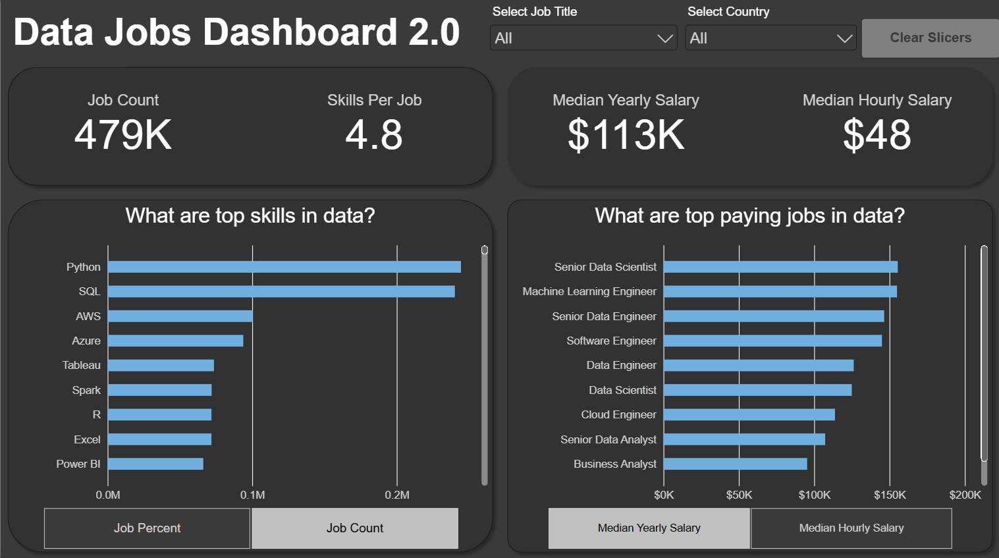

# Featured Dashboards
This repository is a collection of Power BI Ddashboards I've developed in y latest project! It displays my development in using Power BI, from foundational reports and visuals to more advanced analysis, focusing on transforming data into actionable insights.

## Data Jobs Dashboard (V1- Comprehensive Exploration)
Explore the dashboards below, each with its own README discussing the details of each project.

## Key Power BI Skills Utilised
* Dashboard Layout & Design
* Power Query (ETL & Data Shaping)
* Basic Data Modelling (Table Relationships)
* Implicit measures & Standard Aggregations
* Core Charts (Bar, Line, Area, Column)
* Map Visualisations for Geospatial Data
* KPI Cards & Detailed Data Tables
* Interactive Slicers for Filtering
* Buttons & Bookmarks for Page Navigation
* Drill-through Functionality

[**View Full Project 1 Details (README)**](/Data_Jobs_v1/README.md)

## Data Jobs Dashboard (V2- Single-Page Focus)

**Key Power BI Skills Utilised (demonstrating progression)**

* Advanced Dashboard Design (Single-Page UX & Optimisation)
* Complex Power Query Transformations
* Star Schema  Dta Modelling Principles
* Explicit DAX Measures
* Dynamic Visualisations (driven by Parameters/ Slicers)
* Field & Numeric Parameter Implemenation for "What-If" Analysis
* Enahnced Geospatial Insights
* Advanced Card Visualisations
* Optimised Slicers & Advanced Cross-Filtering Techniques
* Report Performance Considerations

[**View Full Project 2 Details (README)**](/Data_Jobs_v2/README.md)

## About this Portfolio

Each dashboard linked above has its own detailed README.md file within its respective project folder. These offer deeper insights into the project objectives, data sources, specific Power BI techniques employed, and a closer look at the dashboard build.